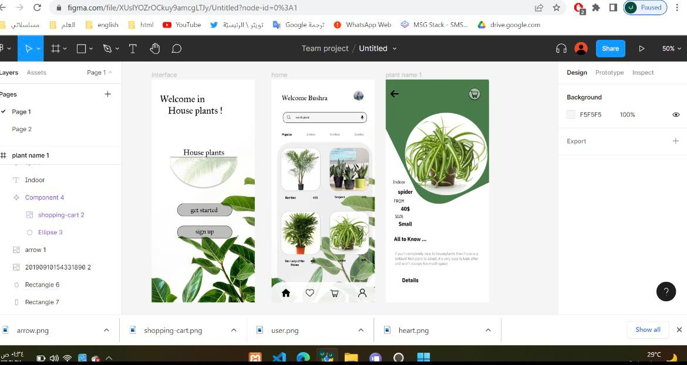
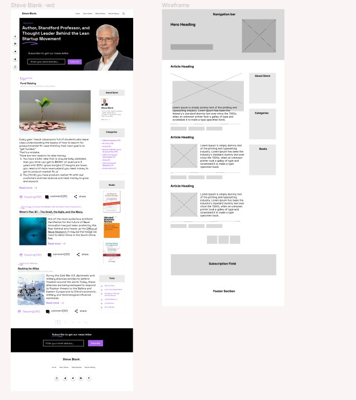
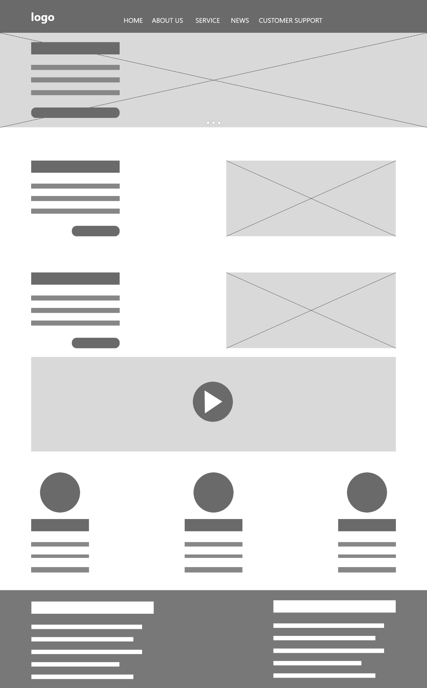
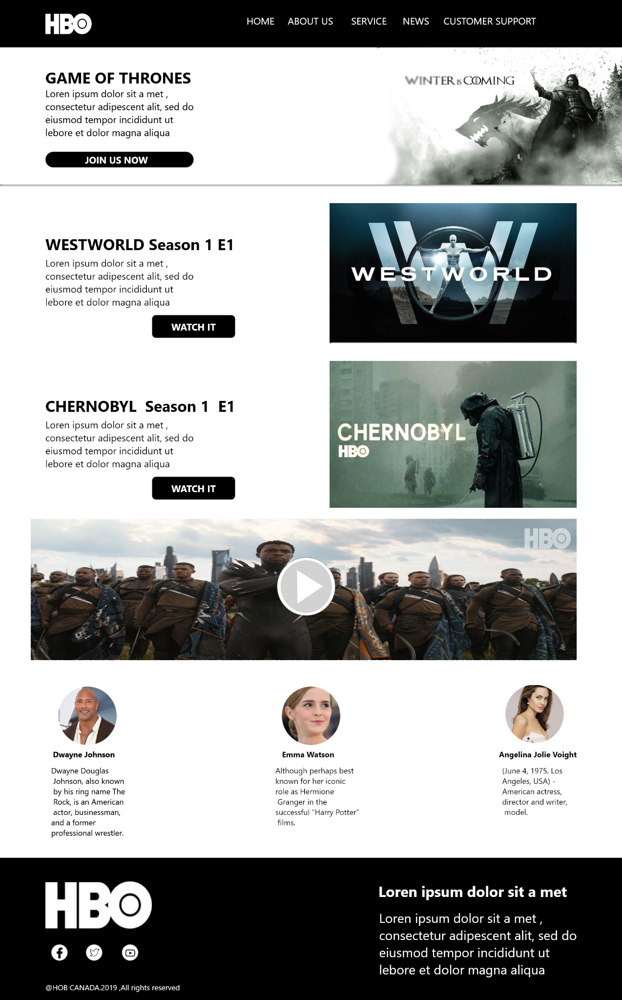

# UI/UX Interface Design Portfolio

A collection of interface designs, wireframes, and layout studies created as hands-on UI design practice for mobile applications and websites.

**Focus areas:** UI layout design, low-fidelity wireframes, visual mockups, navigation planning, screen composition, and web/mobile interface concepts.  
**Tools:** Figma and other visual design software.  
**Portfolio status:** Selected archived screenshots. Original editable design files are not included.

## Selected projects

### 1. House Plants — Mobile Shopping Interface
Mobile storefront concept illustrating onboarding, a product gallery, product details, navigation, and shopping interactions.

### 2. Article / Blog Page — Layout and Wireframe Study
A page-structure study featuring an article feed, sidebar modules, navigation, subscription area, and footer. The left-hand page is a reference, and the right-hand page shows the wireframe.

### 3. Entertainment Landing Page — Wireframe to Visual Mockup
An educational page-layout exercise that develops a low-fidelity page wireframe into a visual mockup.

| Wireframe | Mockup |
| --- | --- |
|  |  |

[View the side-by-side comparison](Web-UI/Entertainment-Page-Study/wireframe-and-mockup.jpg)

**Disclaimer:** This is an unofficial educational design study, not a collaboration or affiliation with HBO or any other brand shown. All third-party logos, photographs, trademarks, and reference-page content remain the property of their respective owners.

## About the work
- These are **interface designs and prototypes**, not claims of production websites or coded applications.
- The portfolio currently contains **screenshots only**. The original editable Figma / design files have not yet been recovered.
- Additional older screenshots (including login/account details) have been held out of the public-upload package to avoid exposing personal information.
- More work can be added under `Mobile-UI` and `Web-UI` over time.

## Skills demonstrated
`UI Design` · `Wireframing` · `Figma` · `Mobile App Interfaces` · `Web Layouts` · `Prototyping Concepts` · `Visual Hierarchy`
